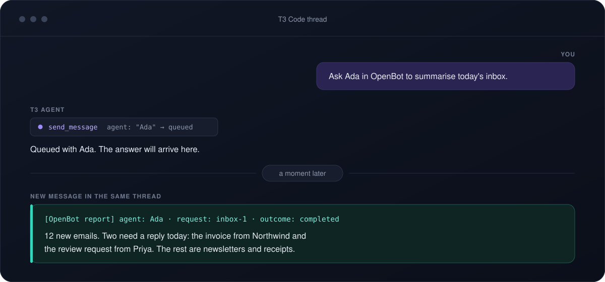
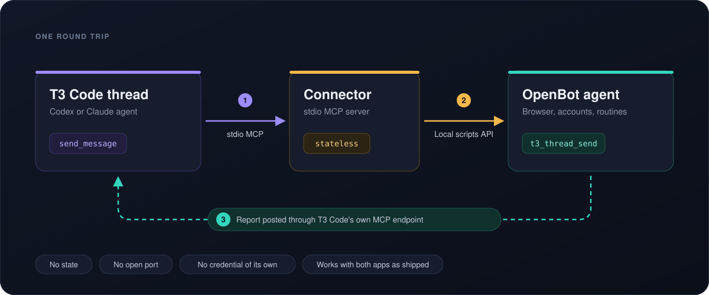

# T3 Code × OpenBot connector

[](https://github.com/sdlyy/t3-openbot-connector/actions/workflows/ci.yml)

Lets an agent in a T3 Code thread hand work to an OpenBot agent and get the
answer back in the same thread, and lets an OpenBot agent delegate coding work to T3 Code. It works
with both apps as shipped.

<p align="center">
  
</p>

## How it works

<p align="center">
  
</p>

The connector is a small stdio MCP server that the Codex or Claude provider inside T3 Code starts on
demand. It keeps no state, opens no port, and holds no credential of its own. OpenBot is an MCP
client but not an MCP server, so this adapter is T3 Code's way in. The way back is T3 Code's
built-in MCP endpoint, which OpenBot connects to directly.

## Why not plain MCP in both directions?

One direction already is plain MCP: OpenBot connects straight to T3 Code's endpoint. The other
direction cannot be, because OpenBot does not serve MCP. Its way in is a local HTTP API whose port
and token change on every start.

| | Plain MCP only | With this connector |
| --- | --- | --- |
| OpenBot agent calls T3 Code | ✅ T3 Code's built-in endpoint | ✅ The same endpoint, untouched |
| T3 Code agent calls OpenBot | ❌ OpenBot has no MCP server | ✅ Six tools over the Local scripts API |
| OpenBot's port and token after a restart | Re-entered by hand | Read fresh on every call |
| Getting the answer back | Nothing links a reply to a request | Tagged report into the thread that asked |
| Knowing which thread asked | You pass the thread ID yourself | Taken from the T3 Code session |
| Retrying a send safely | Duplicates the task | Stable key, deduplicated by OpenBot for 24 hours |
| Agent waiting for a reply that never comes | Common | The task states the report is one-way |
| Failed tasks | Silent | Reported with `outcome: failed` and the reason |
| Two agents answering each other in a loop | Possible | Results are sent with reporting off |
| Extra processes, ports, or secrets | None | None |

The connector adds two things: a translation from OpenBot's HTTP API to MCP tools, and the
convention that makes a one-way send behave like a round trip.

## Requirements

- Node 22 or newer
- T3 Code with the Codex or Claude provider
- OpenBot 0.40.0 or newer

## Set up once

1. **Build and register.** Run this with the Node you want the providers to use.

   ```sh
   git clone https://github.com/sdlyy/t3-openbot-connector.git
   cd t3-openbot-connector
   npm ci
   npm run build
   npm run register
   ```

   `register` adds one `t3_openbot` entry to `~/.codex/config.toml` and one to `~/.claude.json`,
   and leaves everything else in those files alone.

2. **In OpenBot, allow access.** Open the agent, choose **Permissions**, turn on **Local scripts**.
3. **In OpenBot, connect to T3 Code.** Add an MCP server of type **Streamable HTTP** with the URL
   `http://127.0.0.1:3773/mcp`, then **Sign in** with a pairing code from T3 Code
   **Settings → Connections**.
4. **In OpenBot, give the agent its standing instructions.** Copy them from
   [docs/agent-instructions.md](docs/agent-instructions.md).
5. **Check.** `npm run doctor` lists the agent and shows both registrations as current.

## Use

Open a new T3 Code thread and say, for example, "ask Ada in OpenBot to summarise today's inbox". The
T3 agent queues the task and ends its turn. The answer arrives in the same thread as a new message:

```
[OpenBot report] agent: Ada · request: inbox-1 · outcome: completed
...
```

| Tool | What it does |
| --- | --- |
| `openbot_status` | Checks the connection and shows the thread reports go to |
| `list_agents` | Lists agents that allow Local scripts, with their routines |
| `send_message` | Queues a task; the agent reports back into the calling thread |
| `run_routine` | Starts an existing routine now, with an optional payload |
| `list_pending` | Shows questions and approvals an agent is waiting on |
| `answer_prompt` | Answers a pending question |

## How results come back

OpenBot has no way to read a finished answer from outside, so the agent delivers it. The connector
appends a short block to each task that tells the agent to post one tagged report into the T3 thread
and then end its turn. This relies on the agent following the instruction: an agent that crashes or
is stuck on a question does not report, and `list_pending` is how you find out.

## Security

- The connector talks only to `127.0.0.1` and reads only the URL and token files OpenBot publishes
  for the current user.
- OpenBot's per-agent **Local scripts** switch is the grant. An agent without it is unreachable.
- Approvals are never answered through the connector; they stay in OpenBot.
- A report is text written by another agent. The T3 agent is told to treat it as data, not as
  instructions.

## Development

```sh
npm test
```

The tests start the real CLI over stdio against a stand-in for OpenBot's Local scripts API. Set
`T3_OPENBOT_DEBUG=1` to print raw tool errors to stderr.

## More

- [Setup details and troubleshooting](docs/setup.md)
- [Instructions for the OpenBot agent](docs/agent-instructions.md)
- [Design notes](docs/design.md)
- [Changelog](CHANGELOG.md)

This is an independent project, not affiliated with T3 Code or OpenBot. [MIT licensed](LICENSE).
