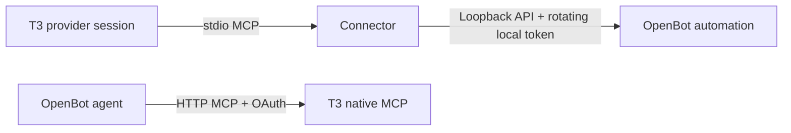

# Design

The connector is a thin, stateless adapter between an MCP client and OpenBot's Local scripts API.
OpenBot owns agents, queues, conversation history, routines, and scheduling. T3 owns its threads.
The connector never opens either application's database and never holds a credential of its own.

## Locating OpenBot

On every request the connector reads OpenBot's `url` and `token` files, so a restarted OpenBot with
a new port and token just works. Without `--automation-dir` or `OPENBOT_AUTOMATION_DIR`, it scans
the platform's application data folder for the installed profile and any development profile that
currently publishes those files. One match is used; none or several is an explicit error.

## Stock OpenBot only

The connector uses only what the shipped Local scripts API offers: list agents, queue a message
with a retry key, start an existing routine, and read or answer pending questions. Those back
`list_agents`, `send_message`, `run_routine`, `list_pending`, and `answer_prompt`. Stock OpenBot has
no route to read a saved answer, so the connector has no tool for it. Earlier versions carried six
more tools for a patched OpenBot build; they were removed in 0.4.0 because a tool that fails on the
app people actually run is worse than no tool.

## Agents by name

Every tool accepts an agent ID or a name. The connector lists the agents that allow Local scripts
on each call and matches the ID first, then the exact name, then the name ignoring case. A name
shared by two agents is refused with `agent_ambiguous` rather than guessed.

## Work and results

`send_message` sends OpenBot's normal message operation with the client key `t3-bridge:<requestId>`.
OpenBot returns the first receipt for that key for 24 hours, which is the only deduplication the
connector relies on. The receipt's `deliveryId` identifies the work from then on.

Results come back because the OpenBot agent reports them. The task text ends with an instruction
to call T3's `t3_thread_send` with a thread, `mode: queue`, and the client key
`openbot-report:<requestId>`, whether the task succeeded or not. The report's first line names the
agent, the request, and the outcome, so several reports in one thread stay sortable and a failure
is visible instead of silent. T3 deduplicates on the key.

The thread is the caller's own by default. T3 Code sets `T3CODE_THREAD_ID` for every provider
session; Claude Code hands its environment to stdio servers, and the Codex registration forwards
that one variable with `env_vars`. A call can name another thread with `reportToThreadId` or turn
reporting off with `report: false`. Outside T3 there is no thread, and the receipt says no result
will come back. The ID is checked against a strict pattern before it is written into the task.

This path depends on the agent following the instruction: a turn that crashes, or an agent stuck on
a question, never reports. The receipt therefore tells the T3 agent to end its turn rather than
wait, and to read `list_pending` if a report is overdue. The server's MCP instructions say the same,
so the T3 agent knows the pattern without a separate skill.

### The report is one-way

`t3_thread_send` returns a receipt, never T3's answer, and nothing on the T3 side wakes the OpenBot
agent afterwards. An agent that does not know this waits for a reply, opens an `openbot.await_event`
wait, or writes what it imagines T3 would say. The instruction therefore ends with the contract: end
the turn after the receipt, do not wait, do not poll the thread, do not guess, and treat any follow-up
as a new message in the queue. A standing rule in the agent's own OpenBot instructions makes this
hold even when a message is long enough for the trailing block to be overlooked; the text is in
[agent-instructions.md](agent-instructions.md).

## Routines and questions

`run_routine` starts an existing routine with an optional payload that OpenBot appends to the
instruction as data. It has no retry key, so a lost acknowledgement may already have started a run.
Schedules are created or changed by asking the agent, which has its own routine tools.

`list_pending` shows questions, approvals, and browser takeovers. `answer_prompt` answers a question
by its opaque request ID; an expired one returns `openbot_conflict`. Approvals are a permission
decision for a person, so the connector exposes no tool to accept or decline them.

## Registration

`install` writes the stdio registration into Codex's `config.toml` and Claude Code's
`~/.claude.json`. It resolves the running Node binary past version-manager shims, so the providers,
which T3 starts without a login shell, get a path that exists. In the TOML file it replaces only the
`[mcp_servers.t3_openbot]` table and its sub-tables, in place, and appends when absent. That table
carries `env_vars = ["T3CODE_THREAD_ID"]`, because Codex starts MCP servers with a reduced environment. In the JSON
file it sets only `mcpServers.t3_openbot`. Both writes are atomic and keep the file's mode.
`doctor` reads both back and reports whether they match this build, whether the Node path exists,
and whether the Codex entry forwards the thread ID.

## Limits and safety

OpenBot enforces its own Local scripts quota, 30 messages and runs per agent per hour, and its
per-agent grant on every request. The connector adds no allowlists and no rate limits of its own.
Input text is capped at 15,000 characters so the report instruction fits under OpenBot's message
limit; run payloads at 4,000.
The connector speaks only to loopback and reads only the files OpenBot writes with mode 0600.
